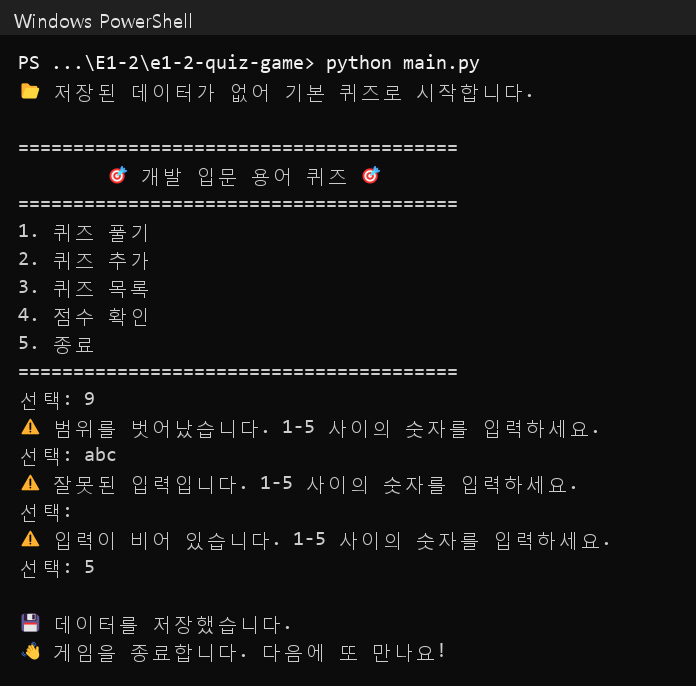
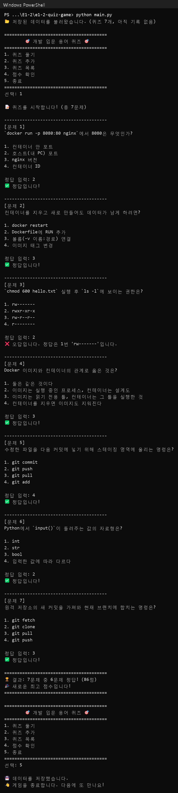
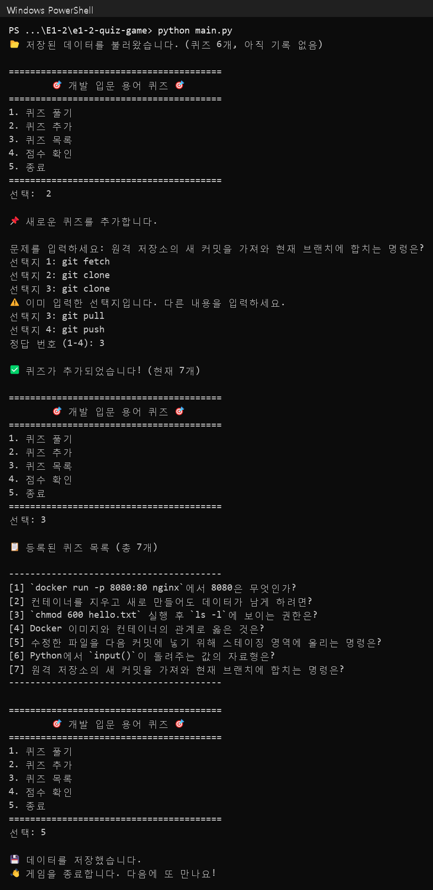
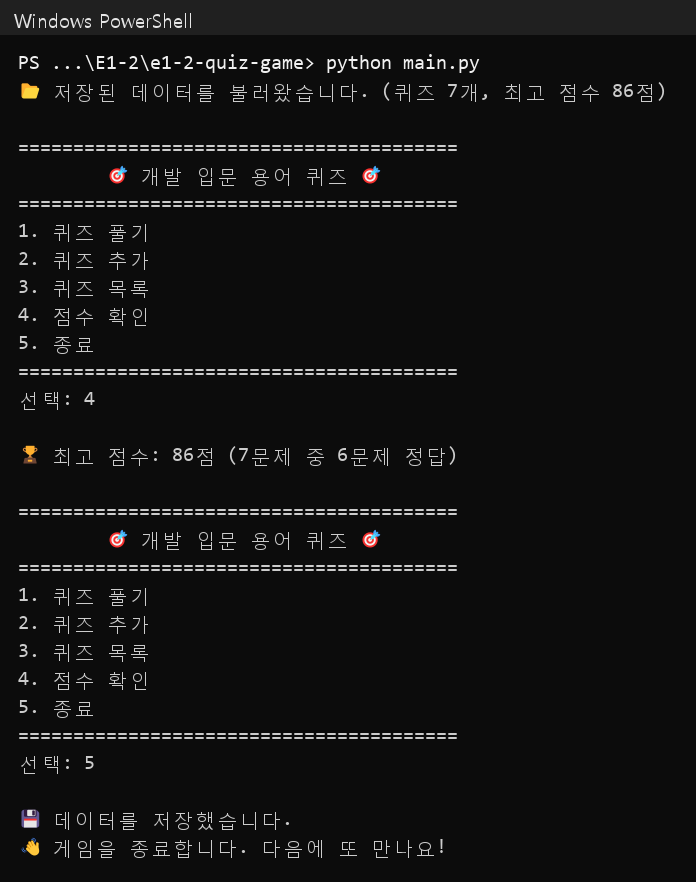

# E1-2 개발 입문 용어 퀴즈 게임

코디세이 입학연수 미션 E1-2 "컴퓨터에게 명령 내리는 말(파이썬) 처음 배우기"의 결과물입니다.

## 1. 프로젝트 개요

터미널에서 동작하는 4지선다 퀴즈 게임입니다.

- 메뉴에서 번호를 골라 퀴즈 풀기, 추가, 목록, 점수 확인을 합니다.
- `Quiz`(퀴즈 한 문제)와 `QuizGame`(게임 전체)의 두 클래스로 역할을 나눴습니다.
- 퀴즈와 최고 점수는 `state.json`에 저장되므로, 종료 후 다시 실행해도 그대로 남습니다.
- Python 3.10 이상의 표준 라이브러리만 사용합니다. 외부 라이브러리는 없습니다.

## 2. 퀴즈 주제와 선정 이유

**주제:** 개발 입문 용어 (Docker, Linux 권한, Git, Python)

**선정 이유**
- **직접 해 본 것을 복습합니다.** E1-1 실습에서 실제로 겪은 상황을 문제로 만들었습니다. 포트 매핑 `-p 8080:80`, 볼륨, `chmod 600`, `git add` 등이 그 예입니다.
- **평가자가 바로 풀 수 있습니다.** 동료평가자도 같은 과정을 듣고 있어서 배경 설명 없이 문제를 풀 수 있습니다.
- **정답이 바뀌지 않습니다.** 기술 개념은 시점에 따라 달라지지 않습니다. 야구처럼 기록과 소속이 바뀌는 주제보다 정답을 검증하기 쉽습니다.

후보였던 "야구"와 6개 기준(설득력, 평가자 접근성, 학습 연계, 정답 검증, 재미, 차별성)으로 비교했습니다. 개발 입문 용어가 76.0점, 야구가 65.5점이라 개발 입문 용어를 골랐습니다.

## 3. 실행 방법

```bash
git clone https://github.com/Hoyasiro/e1-2-quiz-game.git
```
```bash
cd e1-2-quiz-game
```
```bash
python main.py
```

- Python 3.10 이상이 필요합니다. 버전은 `python --version`으로 확인합니다.
- 어느 폴더에서 실행해도 `state.json`은 프로젝트 루트(`main.py`와 같은 폴더)에 저장됩니다.
- 처음 실행하면 기본 퀴즈 6개로 시작하고 `state.json`이 새로 만들어집니다.

## 4. 기능 목록

| 메뉴 | 기능 |
|---|---|
| 1. 퀴즈 풀기 | 등록된 퀴즈를 순서대로 출제하고, 정답·오답을 바로 알려 줍니다. 다 풀면 결과와 점수(100점 만점)를 보여 주고 최고 점수를 갱신합니다. |
| 2. 퀴즈 추가 | 문제, 선택지 4개, 정답 번호를 입력받아 등록하고 바로 저장합니다. 이미 입력한 선택지와 같으면 다시 묻습니다. |
| 3. 퀴즈 목록 | 등록된 퀴즈의 번호와 문제를 보여 줍니다. 정답은 보여 주지 않습니다. |
| 4. 점수 확인 | 최고 점수와 그때 맞힌 문제 수를 보여 줍니다. |
| 5. 종료 | 데이터를 저장하고 게임을 끝냅니다. |

**예외 처리**

| 상황 | 처리 |
|---|---|
| 앞뒤 공백 (` 2 `) | 공백을 지우고 `2`로 처리 |
| 빈 입력 (Enter) | "입력이 비어 있습니다" 안내 후 다시 입력 |
| 숫자가 아님 (`abc`) | "잘못된 입력입니다" 안내 후 다시 입력 |
| 범위 밖 (메뉴 `9`, 정답 `0`) | "범위를 벗어났습니다" 안내 후 다시 입력 |
| 퀴즈가 없음 | 풀기·목록에서 "등록된 퀴즈가 없습니다" 안내 |
| 아직 푼 기록 없음 | 점수 확인에서 "기록이 없습니다" 안내 |
| `Ctrl+C`, 입력 종료(EOF) | 안내 메시지를 보여 주고, 저장한 뒤 종료 |
| `state.json` 없음 | 기본 퀴즈로 시작하고 파일을 새로 만듦 |
| `state.json` 손상 | 안내 후 기본 퀴즈로 복구. 손상된 파일은 `state.json.broken`으로 보관 |
| `state.json`을 읽을 수 없음 | 기본 퀴즈로 실행하되, 기존 파일을 덮어쓰지 않도록 이번 실행에서는 저장하지 않음 |

## 5. 파일 구조

```
e1-2-quiz-game/
├── main.py              # 실행 진입점: QuizGame을 만들고 run() 호출
├── quiz_game.py         # QuizGame 클래스: 메뉴, 풀기, 추가, 목록, 점수, 저장·불러오기
├── quiz.py              # Quiz 클래스: 문제 한 개 (출력, 채점, dict 변환)
├── default_quizzes.py   # 기본 퀴즈 6개를 Quiz 인스턴스로 생성
├── input_helper.py      # 입력 검증 함수 (read_number, read_text)
├── docs/screenshots/    # 실행 화면 캡처
├── .gitignore           # 캐시, 가상환경, state.json 등 제외
├── README.md
└── state.json           # 실행하면 생기는 데이터 파일 (Git에는 올리지 않음)
```

**클래스와 주요 메서드**

| 클래스 | 속성 | 메서드 |
|---|---|---|
| `Quiz` | `question`, `choices`(4개), `answer`(1~4) | `display()` 출력, `is_correct()` 채점, `correct_choice()` 정답 내용, `to_dict()` / `from_dict()` JSON 변환 |
| `QuizGame` | `quizzes`, `best_score`, `best_correct`, `best_total`, `state_file` | `run()`, `menu_loop()`, `show_menu()`, `play()`, `add_quiz()`, `show_quizzes()`, `show_score()`, `load_state()`, `save_state()` |

## 6. 데이터 파일 설명 (`state.json`)

- **경로:** 프로젝트 루트의 `state.json` (`main.py`와 같은 폴더)
- **역할:** 추가한 퀴즈와 최고 점수를 저장해, 종료 후 다시 실행해도 유지합니다.
- **인코딩:** UTF-8. 한글이 그대로 보이도록 `ensure_ascii=False`로 저장합니다.
- **저장 시점:** 퀴즈를 추가했을 때, 최고 점수가 바뀌었을 때, 종료할 때(`Ctrl+C`·EOF 포함)
- **안전한 저장:** 먼저 `state.json.tmp`에 쓴 뒤 `state.json`과 바꿉니다. 저장 도중 멈춰도 기존 파일이 깨지지 않습니다.
- **Git 제외:** 실행할 때마다 내용이 바뀌는 파일이라 `.gitignore`에 넣었습니다.

**스키마**

| 키 | 자료형 | 설명 |
|---|---|---|
| `quizzes` | list | 퀴즈 목록 |
| `quizzes[].question` | str | 문제 |
| `quizzes[].choices` | list[str] | 선택지 4개 |
| `quizzes[].answer` | int | 정답 번호 (1~4) |
| `best_score` | int 또는 null | 최고 점수 (0~100). 아직 풀지 않았으면 `null` |
| `best_correct` | int | 최고 점수를 냈을 때 맞힌 문제 수 |
| `best_total` | int | 최고 점수를 냈을 때 전체 문제 수 |

**예시**

```json
{
  "quizzes": [
    {
      "question": "수정한 파일을 다음 커밋에 넣기 위해 스테이징 영역에 올리는 명령은?",
      "choices": ["git commit", "git push", "git pull", "git add"],
      "answer": 4
    }
  ],
  "best_score": 100,
  "best_correct": 7,
  "best_total": 7
}
```

`quizzes`와 `best_score`만 있는 최소 형태도 읽을 수 있습니다. 형식이 틀리면(예: 정답이 5, 선택지가 3개) 손상된 파일로 보고 기본 퀴즈로 복구합니다.

## 7. 실행 화면

| 메뉴 | 퀴즈 풀기 |
|---|---|
|  |  |

| 퀴즈 추가 | 점수 확인 |
|---|---|
|  |  |
