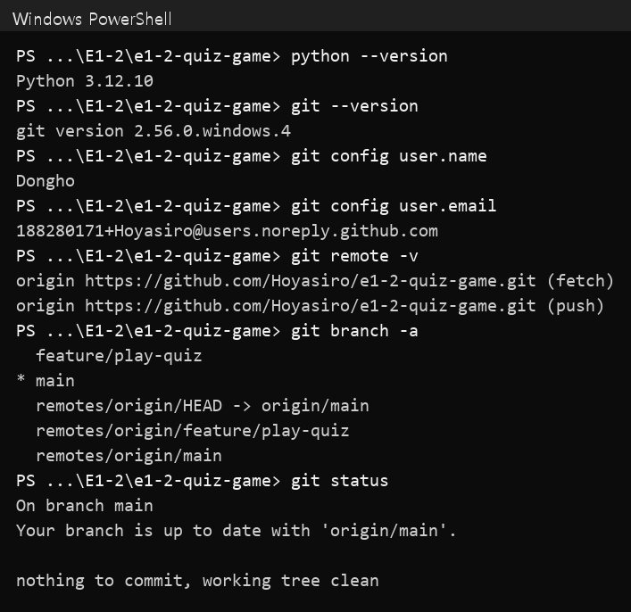
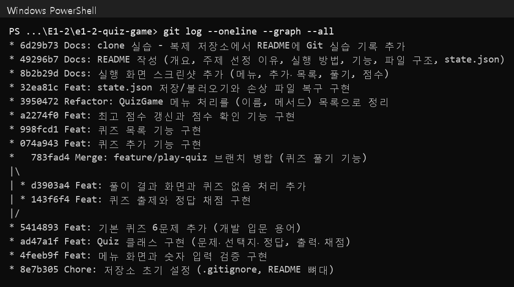

# E1-2 개발 입문 용어 퀴즈 게임

코디세이 입학연수 미션 E1-2 "컴퓨터에게 명령 내리는 말(파이썬) 처음 배우기"의 결과물입니다.

## 1. 프로젝트 개요

터미널에서 동작하는 4지선다 퀴즈 게임입니다.

- 메뉴에서 번호를 골라 퀴즈 풀기, 추가, 목록, 점수 확인을 합니다.
- `Quiz`(퀴즈 한 문제)와 `QuizGame`(게임 전체)의 두 클래스로 역할을 나눴습니다.
- 퀴즈와 최고 점수는 `state.json`에 저장되므로, 종료 후 다시 실행해도 그대로 남습니다.
- Python 3.10 이상의 표준 라이브러리만 사용합니다. 외부 라이브러리는 없습니다.

## 2. 퀴즈 주제와 선정 이유

**주제:** 개발 입문 용어 (Docker, Linux 권한, Git, Python)

**선정 이유**
- **직접 해 본 것을 복습합니다.** E1-1 실습에서 실제로 겪은 상황을 문제로 만들었습니다. 포트 매핑 `-p 8080:80`, 볼륨, `chmod 600`, `git add` 등이 그 예입니다.
- **평가자가 바로 풀 수 있습니다.** 동료평가자도 같은 과정을 듣고 있어서 배경 설명 없이 문제를 풀 수 있습니다.
- **정답이 바뀌지 않습니다.** 기술 개념은 시점에 따라 달라지지 않습니다. 야구처럼 기록과 소속이 바뀌는 주제보다 정답을 검증하기 쉽습니다.

후보였던 "야구"와 6개 기준(설득력, 평가자 접근성, 학습 연계, 정답 검증, 재미, 차별성)으로 비교했습니다. 개발 입문 용어가 76.0점, 야구가 65.5점이라 개발 입문 용어를 골랐습니다.

## 3. 실행 방법

```bash
git clone https://github.com/Hoyasiro/e1-2-quiz-game.git
```
```bash
cd e1-2-quiz-game
```
```bash
python main.py
```

- Python 3.10 이상이 필요합니다. 버전은 `python --version`으로 확인합니다.
- 어느 폴더에서 실행해도 `state.json`은 프로젝트 루트(`main.py`와 같은 폴더)에 저장됩니다.
- 처음 실행하면 기본 퀴즈 6개로 시작하고 `state.json`이 새로 만들어집니다.

## 4. 기능 목록

| 메뉴 | 기능 |
|---|---|
| 1. 퀴즈 풀기 | 등록된 퀴즈를 순서대로 출제하고, 정답·오답을 바로 알려 줍니다. 다 풀면 결과와 점수(100점 만점)를 보여 주고 최고 점수를 갱신합니다. |
| 2. 퀴즈 추가 | 문제, 선택지 4개, 정답 번호를 입력받아 등록하고 바로 저장합니다. 이미 입력한 선택지와 같으면 다시 묻습니다. |
| 3. 퀴즈 목록 | 등록된 퀴즈의 번호와 문제를 보여 줍니다. 정답은 보여 주지 않습니다. |
| 4. 점수 확인 | 최고 점수와 그때 맞힌 문제 수를 보여 줍니다. |
| 5. 종료 | 데이터를 저장하고 게임을 끝냅니다. |

**예외 처리**

| 상황 | 처리 |
|---|---|
| 앞뒤 공백 (` 2 `) | 공백을 지우고 `2`로 처리 |
| 빈 입력 (Enter) | "입력이 비어 있습니다" 안내 후 다시 입력 |
| 숫자가 아님 (`abc`) | "잘못된 입력입니다" 안내 후 다시 입력 |
| 범위 밖 (메뉴 `9`, 정답 `0`, 음수 `-1`) | "범위를 벗어났습니다" 안내 후 다시 입력 |
| 소수 (`1.5`) | `int()` 변환 실패로 보고 "잘못된 입력입니다" 안내 후 다시 입력 |
| 경계값 (`1`, 메뉴 `5`, 정답 `4`) | 허용 범위 안이므로 정상 처리 |
| 퀴즈 추가 때 빈 문제·선택지, 중복 선택지 | 안내 후 그 항목만 다시 입력 |
| 퀴즈가 없음 | 풀기·목록에서 "등록된 퀴즈가 없습니다" 안내 |
| 아직 푼 기록 없음 | 점수 확인에서 "기록이 없습니다" 안내 |
| `Ctrl+C`, 입력 종료(EOF) | 안내 메시지를 보여 주고, 저장한 뒤 종료 |
| `state.json` 없음 | 기본 퀴즈로 시작하고 파일을 새로 만듦 |
| `state.json` 손상 | 안내 후 기본 퀴즈로 복구. 손상된 파일은 `state.json.broken`으로 보관 |
| `state.json`을 읽을 수 없음 | 기본 퀴즈로 실행하되, 기존 파일을 덮어쓰지 않도록 이번 실행에서는 저장하지 않음 |
| 저장 실패 (디스크 가득 참, 권한 없음 등) | "데이터를 저장하지 못했습니다" 안내. 임시 파일만 지우고 기존 `state.json`은 그대로 둠 |

**자동 테스트**

입력 검증, 정답 판정, 저장·불러오기, 손상 파일 복구, `Ctrl+C`·EOF 저장을 `unittest` 17개로 확인합니다. 프로젝트 루트에서 실행합니다.

```bash
python -m unittest discover tests -v
```

## 5. 파일 구조

```
e1-2-quiz-game/
├── main.py              # 실행 진입점: QuizGame을 만들고 run() 호출
├── quiz_game.py         # QuizGame 클래스: 메뉴, 풀기, 추가, 목록, 점수, 저장·불러오기
├── quiz.py              # Quiz 클래스: 문제 한 개 (출력, 채점, dict 변환)
├── default_quizzes.py   # 기본 퀴즈 6개를 Quiz 인스턴스로 생성
├── input_helper.py      # 입력 검증 함수 (read_number, read_text)
├── tests/
│   └── test_quiz_game.py  # unittest 자동 테스트
├── docs/screenshots/    # 실행 화면 캡처
├── .gitignore           # 캐시, 가상환경, state.json 등 제외
├── README.md
└── state.json           # 실행하면 생기는 데이터 파일 (Git에는 올리지 않음)
```

**클래스와 주요 메서드**

| 클래스 | 속성 | 메서드 |
|---|---|---|
| `Quiz` | `question`, `choices`(4개), `answer`(1~4) | `display()` 출력, `is_correct()` 채점, `correct_choice()` 정답 내용, `to_dict()` / `from_dict()` JSON 변환 |
| `QuizGame` | `quizzes`, `best_score`, `best_correct`, `best_total`, `state_file` | `run()`, `menu_loop()`, `show_menu()`, `play()`, `add_quiz()`, `show_quizzes()`, `show_score()`, `load_state()`, `save_state()` |

**클래스를 쓴 이유 (객체지향 vs 함수 중심)**

- **함께 쓰는 데이터를 한곳에 묶습니다.** 문제·선택지·정답은 항상 같이 다닙니다. 함수만 쓰면 `display(question, choices)`, `check(answer, user)`처럼 매번 세 값을 따로 넘겨야 합니다. `Quiz` 객체로 묶으면 `quiz.display()`, `quiz.is_correct(3)`처럼 객체 하나만 다루면 됩니다.
- **상태를 전역 변수 없이 관리합니다.** 퀴즈 목록과 최고 점수는 여러 메뉴가 같이 읽고 바꿉니다. 함수 중심이면 전역 변수를 쓰거나 모든 함수에 인자로 넘겨야 합니다. `QuizGame`은 이 값을 `self`에 두고, 메서드가 `self.quizzes`, `self.best_score`로 꺼내 씁니다.
- **검사를 한곳에서 합니다.** 선택지가 4개인지, 정답이 1~4인지는 `Quiz.__init__`에서만 검사합니다. 직접 입력한 퀴즈와 파일에서 읽은 퀴즈가 모두 이 검사를 거칩니다.
- **함수 중심 방식의 장점:** 이 정도 크기라면 함수와 dict만으로도 만들 수 있고, 코드가 더 짧습니다. 다만 기능이 늘면 함수 인자와 전역 변수가 늘어 고치기 어려워집니다. 그래서 상태가 있는 부분은 클래스로, 상태가 없는 입력 검증은 함수(`input_helper.py`)로 나눴습니다.

**책임 경계**

| 구성 요소 | 맡는 일 | 맡지 않는 일 |
|---|---|---|
| `Quiz` | 문제 한 개의 데이터, 출력, 채점, dict 변환과 형식 검사 | 입력받기, 파일 읽고 쓰기, 점수 계산 |
| `QuizGame` | 메뉴 흐름, 점수 계산과 최고 점수 갱신, `state.json` 저장·불러오기 | 퀴즈 한 개의 형식 검사(→ `Quiz`), 숫자 검증(→ `input_helper`) |
| `input_helper` | 공백 제거, 빈 입력·문자·범위 검사 후 다시 묻기 | 게임 상태 |

**호출 흐름**

```
main.py ─ QuizGame.run()
            ├─ load_state() ─ json.load ─ apply_state() ─ Quiz.from_dict() (형식 검사)
            ├─ menu_loop() ─ read_number() (입력 검증)
            │     ├─ play() ─ ask_quiz() ─ Quiz.display() / read_number() / Quiz.is_correct()
            │     │          └─ show_result() ─ update_best_score() ─ save_state()
            │     ├─ add_quiz() ─ read_text() / read_choices() / read_number() ─ Quiz() ─ save_state()
            │     ├─ show_quizzes()
            │     └─ show_score()
            └─ (종료·Ctrl+C·EOF) save_state() ─ Quiz.to_dict() ─ json.dump
```

**요구사항이 바뀌면 고칠 곳**

| 변경 예시 | 고칠 파일 | 순서 |
|---|---|---|
| 메뉴 추가 (예: 퀴즈 삭제) | `quiz_game.py` | 메서드를 만들고 `menu_actions`에 한 줄 추가 |
| 퀴즈에 힌트 필드 추가 | `quiz.py` → `quiz_game.py` → `default_quizzes.py` | `Quiz` 속성과 `to_dict`/`from_dict`를 먼저 고치고, 입력·출력 화면을 그다음에 고침. 기존 파일에 없는 키는 기본값으로 읽어 호환 유지 |
| 선택지 개수 변경 | `quiz.py` | `CHOICE_COUNT` 한 곳만 바꾸면 검사·입력 범위가 함께 바뀜 |
| 입력 안내 문구 변경 | `input_helper.py` | 메뉴·정답·퀴즈 추가 입력에 모두 반영됨 |
| 저장 방식 변경 (예: SQLite) | `quiz_game.py` | `load_state`·`save_state`만 바꾸면 되고 나머지 메뉴 코드는 그대로 |

## 6. 데이터 파일 설명 (`state.json`)

- **경로:** 프로젝트 루트의 `state.json` (`main.py`와 같은 폴더)
- **역할:** 추가한 퀴즈와 최고 점수를 저장해, 종료 후 다시 실행해도 유지합니다.
- **인코딩:** UTF-8. 한글이 그대로 보이도록 `ensure_ascii=False`로 저장합니다.
- **저장 시점:** 퀴즈를 추가했을 때, 최고 점수가 바뀌었을 때, 종료할 때(`Ctrl+C`·EOF 포함)
- **안전한 저장:** 먼저 `state.json.tmp`에 쓴 뒤 `state.json`과 바꿉니다. 저장 도중 멈춰도 기존 파일이 깨지지 않습니다.
- **Git 제외:** 실행할 때마다 내용이 바뀌는 파일이라 `.gitignore`에 넣었습니다.

**스키마**

| 키 | 자료형 | 설명 |
|---|---|---|
| `quizzes` | list | 퀴즈 목록 |
| `quizzes[].question` | str | 문제 |
| `quizzes[].choices` | list[str] | 선택지 4개 |
| `quizzes[].answer` | int | 정답 번호 (1~4) |
| `best_score` | int 또는 null | 최고 점수 (0~100). 아직 풀지 않았으면 `null` |
| `best_correct` | int | 최고 점수를 냈을 때 맞힌 문제 수 |
| `best_total` | int | 최고 점수를 냈을 때 전체 문제 수 |

**예시**

```json
{
  "quizzes": [
    {
      "question": "수정한 파일을 다음 커밋에 넣기 위해 스테이징 영역에 올리는 명령은?",
      "choices": ["git commit", "git push", "git pull", "git add"],
      "answer": 4
    }
  ],
  "best_score": 100,
  "best_correct": 7,
  "best_total": 7
}
```

`quizzes`와 `best_score`만 있는 최소 형태도 읽을 수 있습니다. 형식이 틀리면(예: 정답이 5, 선택지가 3개) 손상된 파일로 보고 기본 퀴즈로 복구합니다.

**불러오기·저장 순서**

- **불러오기:** `load_state()`가 파일을 엽니다 → `json.load`로 dict로 바꿉니다 → `apply_state()`가 모든 값을 검사합니다(퀴즈마다 `Quiz.from_dict`) → 검사를 다 통과한 뒤에만 게임 상태를 한꺼번에 바꿉니다. 중간에 실패해도 반쯤 바뀐 상태가 남지 않습니다.
- **저장:** `save_state()`가 상태를 dict로 만듭니다(퀴즈마다 `Quiz.to_dict`) → `state.json.tmp`에 다 씁니다 → `os.replace`로 `state.json`과 바꿉니다. 바꾸기는 한 번에 일어나므로 저장 도중 멈춰도 기존 파일은 온전합니다.
- **저장 실패:** 안내 메시지를 보여 주고 임시 파일만 지웁니다. 기존 `state.json`은 마지막으로 저장에 성공한 상태로 남습니다.
- **수동 복구:** `state.json.broken`을 열어 고친 뒤 이름을 `state.json`으로 바꾸면 다시 불러옵니다. 처음부터 시작하려면 `state.json`을 지우면 됩니다.

**필드 설계 이유**

| 필드 | 이유 |
|---|---|
| `quizzes` (list) | 출제 순서를 지켜야 하므로 순서가 있는 list를 썼습니다. 추가한 퀴즈는 끝에 붙습니다. |
| `question`·`choices`·`answer` (퀴즈마다 dict) | `Quiz` 클래스의 속성과 1:1로 맞췄습니다. `to_dict()`/`from_dict()`로 그대로 오가므로 변환 코드가 단순합니다. |
| `answer` (번호, int) | 선택지 내용 대신 번호를 저장하면 사용자 입력(1~4)과 바로 비교할 수 있고, 선택지 문구를 고쳐도 정답이 깨지지 않습니다. |
| `best_score` (int 또는 null) | `null`은 "아직 안 풀었음", `0`은 "풀었는데 0점"이라 둘을 구분합니다. |
| `best_correct`·`best_total` | 점수만 저장하면 "86점"이 몇 문제 중 몇 개인지 알 수 없습니다. 퀴즈를 추가하면 전체 문제 수도 바뀌므로, 최고 점수를 낸 당시의 값을 따로 저장해 "(7문제 중 6문제 정답)"으로 보여 줍니다. |

**중첩 구조를 쓴 이유:** 최상위를 dict로 두면 나중에 `history` 같은 키를 추가해도 기존 키를 읽는 코드가 깨지지 않습니다. 퀴즈를 각각 dict로 묶어 두면 문제 하나가 자기 데이터를 모두 가지고 있어, 선택지 목록과 정답 목록을 따로 관리하다 순서가 어긋날 일이 없습니다.

**JSON으로 저장한 이유와 한계**

- **장점:** 사람이 메모장으로 열어 읽고 고칠 수 있습니다. Python의 dict·list와 구조가 같아 표준 라이브러리 `json`만으로 저장할 수 있습니다. 웹 API와 JavaScript 등 다른 언어도 그대로 읽을 수 있어 나중에 웹 화면과 연동하기 쉽습니다.
- **한계 1 (성능·메모리):** 퀴즈 하나만 바꿔도 파일 전체를 다시 씁니다. 불러올 때도 전부 메모리에 올립니다. 퀴즈가 수만 개로 늘면 느려집니다.
- **한계 2 (동시 실행):** 게임을 두 개 동시에 실행하면, 나중에 저장한 쪽이 앞의 저장 내용을 덮어씁니다. 파일 잠금은 구현하지 않았습니다. 이 게임은 한 사람이 한 번에 하나만 실행한다고 가정합니다.
- **한계 3 (검색):** "Git 문제만 보기" 같은 조건 검색을 하려면 전부 읽은 뒤 코드로 걸러야 합니다.
- **대안:** 데이터가 많아지거나 여러 사람이 동시에 쓴다면 SQLite(Python 표준 라이브러리 `sqlite3`) 같은 데이터베이스가 맞습니다. 바뀐 행만 저장하고, 동시 접근을 잠금으로 막고, SQL로 검색할 수 있습니다. 저장 코드가 `load_state`·`save_state`에 모여 있어 이 두 메서드만 바꾸면 됩니다.

## 7. 실행 화면

| 메뉴 | 퀴즈 풀기 |
|---|---|
|  |  |

| 퀴즈 추가 | 점수 확인 |
|---|---|
|  |  |

| 개발 환경 | `git log --oneline --graph` |
|---|---|
|  |  |

| 화면 | 실행 명령과 입력 | 확인할 결과 |
|---|---|---|
| `menu.png` | 첫 실행 `python main.py` → `9`, `abc`, Enter, `5` | 기본 퀴즈로 시작, 세 가지 잘못된 입력 안내, 저장 후 종료 |
| `add_quiz.png` | 메뉴 ` 2 `(공백 포함) → 퀴즈 입력(중복 선택지 포함) → `3` | 공백 제거, 중복 선택지 재입력, 추가 후 목록 7개 |
| `play.png` | 메뉴 `1` → 7문제 풀이(1개 오답) | 정답·오답 안내, 결과 86점, 새 최고 점수 |
| `score.png` | 다시 실행 → `4` | 불러오기 안내(퀴즈 7개, 최고 86점), 최고 점수 유지 |
| `env.png` | `python --version`, `git --version`, `git config`, `git remote -v` | Python 3.12.10, Git 2.56.0, 원격 저장소 연결 |

## 8. Git 실습 기록

- 이 줄은 저장소를 다른 폴더(`e1-2-quiz-game-clone`)에 `git clone`한 뒤, 그 복제본에서 추가하고 `commit`·`push`했습니다.
- 원래 작업 폴더(`e1-2-quiz-game`)에서는 `git pull`로 이 변경을 받아 반영을 확인했습니다.
- 퀴즈 풀기 기능은 `feature/play-quiz` 브랜치에서 만들고 `git checkout main` 후 `git merge --no-ff`로 병합했습니다.

**커밋 규칙**

- **한 커밋에 한 기능:** 메뉴, Quiz 클래스, 기본 퀴즈, 퀴즈 풀기, 추가, 목록, 점수, 저장처럼 기능 하나가 동작하는 시점마다 커밋했습니다. 커밋 하나만 되돌려도 그 기능만 빠지도록 하기 위해서입니다.
- **커밋마다 실행 확인:** 커밋 전에 `python main.py`로 그 기능이 동작하는지 확인했습니다. 어느 커밋으로 돌아가도 프로그램이 실행됩니다.
- **메시지 형식:** `종류: 무엇을 했는지` 한 줄 요약. 필요하면 빈 줄 뒤에 `- 세부 변경`을 적습니다.

| 종류 | 쓰는 때 | 예 |
|---|---|---|
| `Feat` | 기능 추가 | `Feat: 퀴즈 추가 기능 구현` |
| `Fix` | 버그 수정 | `Fix: 점수 계산 오류 수정` |
| `Refactor` | 동작은 같고 구조만 개선 | `Refactor: QuizGame 메뉴 처리를 (이름, 메서드) 목록으로 정리` |
| `Docs` | 문서·스크린샷 | `Docs: README 작성` |
| `Test` | 테스트 추가 | `Test: 입력 검증, Quiz, state.json 저장·복구 단위 테스트 추가` |
| `Chore` | 설정 등 기타 | `Chore: 저장소 초기 설정 (.gitignore, README 뼈대)` |

**브랜치 전략과 병합의 의미**

- `main`은 **언제나 실행되는 버전**만 둡니다. 퀴즈 풀기는 출제, 채점, 결과 화면을 여러 커밋에 걸쳐 만드는 가장 큰 기능이라 `feature/play-quiz` 브랜치로 분리했습니다. 만드는 도중의 미완성 코드가 `main`에 섞이지 않습니다.
- 기능이 완성되고 실행을 확인한 뒤 `main`으로 병합했습니다. 팀 작업에서는 이 단계에서 PR을 열어 코드 리뷰를 받습니다.
- `--no-ff`로 병합 커밋을 남겨, 아래 그래프에서 "이 두 커밋은 퀴즈 풀기 기능 묶음"이라는 것이 갈래로 보이게 했습니다. `main`에 그 사이 다른 커밋이 없어 충돌은 없었습니다.

**사용한 Git 명령 7종**

| 명령 | 사용한 곳 |
|---|---|
| `init` | 저장소 초기 설정 |
| `add`, `commit` | 기능마다 (아래 기록) |
| `push` | 기능 커밋 후 GitHub에 올릴 때, `feature/play-quiz` 브랜치도 원격에 업로드 |
| `checkout` | `checkout -b feature/play-quiz`로 브랜치 생성·이동, `checkout main`으로 복귀 |
| `clone` | `e1-2-quiz-game-clone` 폴더에 복제 |
| `pull` | 복제본에서 올린 커밋을 원래 폴더로 받음 |

**커밋 기록 (`git log --oneline --graph`, Test 커밋까지 17개)**

```
* 6ba38d4 Test: 입력 검증, Quiz, state.json 저장·복구 단위 테스트 추가
* 78afb43 Docs: 개발 환경과 git log 그래프 스크린샷 추가
* 6d29b73 Docs: clone 실습 - 복제 저장소에서 README에 Git 실습 기록 추가
* 49296b7 Docs: README 작성 (개요, 주제 선정 이유, 실행 방법, 기능, 파일 구조, state.json)
* 8b2b29d Docs: 실행 화면 스크린샷 추가 (메뉴, 추가·목록, 풀기, 점수)
* 32ea81c Feat: state.json 저장/불러오기와 손상 파일 복구 구현
* 3950472 Refactor: QuizGame 메뉴 처리를 (이름, 메서드) 목록으로 정리
* a2274f0 Feat: 최고 점수 갱신과 점수 확인 기능 구현
* 998fcd1 Feat: 퀴즈 목록 기능 구현
* 074a943 Feat: 퀴즈 추가 기능 구현
*   783fad4 Merge: feature/play-quiz 브랜치 병합 (퀴즈 풀기 기능)
|\
| * d3903a4 Feat: 풀이 결과 화면과 퀴즈 없음 처리 추가
| * 143f6f4 Feat: 퀴즈 출제와 정답 채점 구현
|/
* 5414893 Feat: 기본 퀴즈 6문제 추가 (개발 입문 용어)
* ad47a1f Feat: Quiz 클래스 구현 (문제·선택지·정답, 출력·채점)
* 4feeb9f Feat: 메뉴 화면과 숫자 입력 검증 구현
* 8e7b305 Chore: 저장소 초기 설정 (.gitignore, README 뼈대)
```

이 README 보강 커밋이 그 위에 더해집니다. 최신 기록은 저장소에서 `git log --oneline --graph`로 확인할 수 있습니다.
